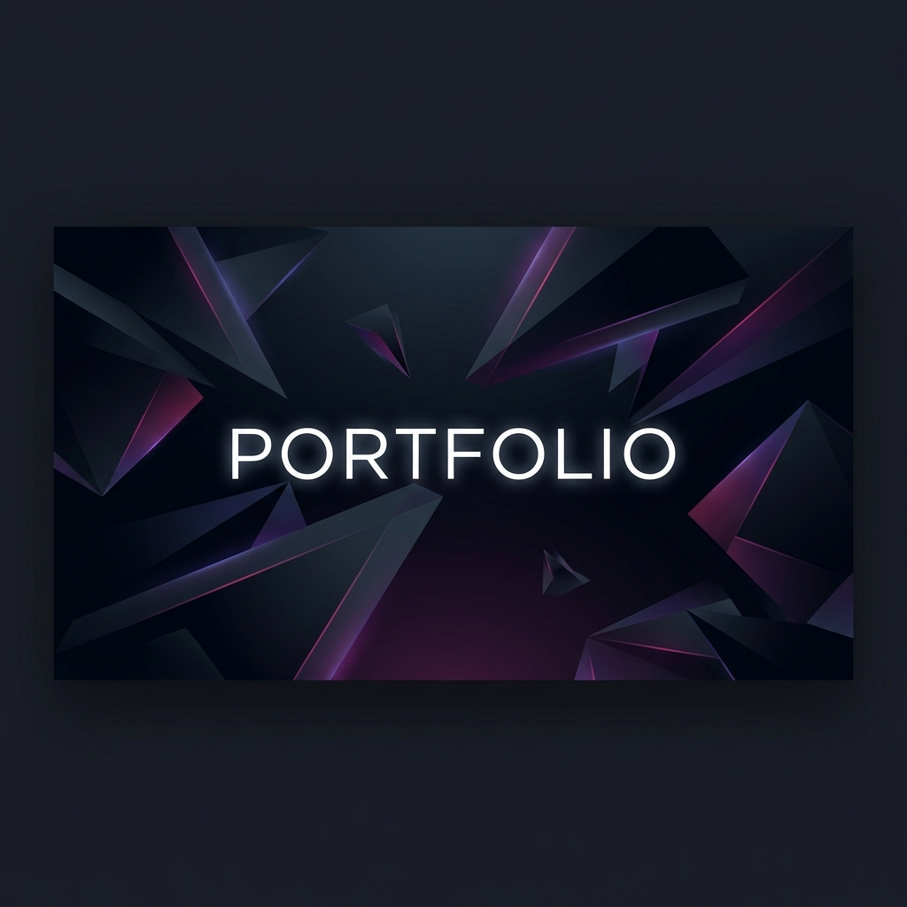

<div align="center">
  
  
  # 🚀 Dev Das | Full-Stack Developer Portfolio

  A sleek, high-performance portfolio website built with **Next.js 16**, **React 19**, **Tailwind CSS v4**, **Supabase**, and **Framer Motion**. Designed with an OKLCH-based modern design system, interactive case studies, dynamic blogs, and an authenticated admin control center.

  [Live Demo](https://devdas.tech) · [Report Bug](https://github.com/devd-328/portfolio/issues) · [Request Feature](https://github.com/devd-328/portfolio/issues)

  ---

  [](https://nextjs.org/)
  [](https://react.dev/)
  [](https://tailwindcss.com/)
  [](https://www.typescriptlang.org/)
  [](https://supabase.com/)
  [](https://www.framer.com/motion/)
  [](https://vercel.com/)

</div>

---

## 🌟 Highlights & Key Features

- 🎨 **Modern Design System & Theming**
  - Crafted with **Tailwind CSS v4** and a custom **OKLCH color token architecture** (Tech Indigo, Cyan, and Deep Violet).
  - Seamless Light and Dark mode transitions powered by `next-themes` and glassmorphic micro-interactions.
- ⚡ **Next.js 16 & React 19 Core**
  - Built on the Next.js App Router for server-rendered performance and optimal Core Web Vitals.
  - Fluid route transitions and micro-interactions orchestrated via **Framer Motion 12**.
- 💼 **Interactive Case Studies & Project Gallery**
  - Dedicated project showcase with rich case study breakdowns (*Challenge*, *Solution*, *Result*).
  - Interactive multi-image lightbox gallery powered by `yet-another-react-lightbox`.
- 📝 **Rich Text Blog System**
  - Dynamic blog publishing workflow with tags, slug routing, and publication states.
  - WYSIWYG editor integration with `react-quill-new` and sanitization via `dompurify` / `isomorphic-dompurify`.
- 🛠️ **Dynamic Skills Showcase**
  - Categorized skill matrices (Frontend, Backend, Database, Cloud/DevOps, Tools) rendered dynamically from Supabase.
- 🔐 **Secure Admin Control Center**
  - Full CRUD operations for projects, blogs, and skills.
  - Multi-Factor Authentication (**MFA / TOTP 2FA**) enrollment and verification for administrator security.
  - Multi-image uploads and PDF resume management backed by **Supabase Storage**.
  - Integrated page view analytics and dashboard metrics.
- 📮 **Reliable Contact Flow**
  - Direct contact form backed by a Next.js API route with CORS validation, input constraints, and **Nodemailer** Gmail transport.
- 🔍 **SEO & Performance Tuned**
  - Automated `sitemap.ts`, `robots.ts`, Open Graph / Twitter meta tags, and structured JSON-LD data.
  - Performance monitoring via **Vercel Analytics** and **Speed Insights**.

---

## 💻 Tech Stack

| Category | Technologies |
| :--- | :--- |
| **Framework** | [Next.js 16](https://nextjs.org/) (App Router), [React 19](https://react.dev/) |
| **Language** | [TypeScript 5](https://www.typescriptlang.org/) |
| **Styling** | [Tailwind CSS v4](https://tailwindcss.com/), `@tailwindcss/typography`, OKLCH Design Tokens |
| **UI Components** | [Radix UI](https://www.radix-ui.com/), [Lucide React](https://lucide.dev/), [Sonner](https://sonner.emilkowal.ski/), [yet-another-react-lightbox](https://yet-another-react-lightbox.com/) |
| **Animations** | [Framer Motion 12](https://www.framer.com/motion/) |
| **Database & Auth** | [Supabase](https://supabase.com/) (PostgreSQL, Row-Level Security, Storage, Auth with MFA) |
| **Rich Text & Sanitization** | `react-quill-new`, `dompurify`, `isomorphic-dompurify` |
| **Email Service** | [Nodemailer](https://nodemailer.com/) (Gmail SMTP Transport) |
| **Analytics & Hosting** | [Vercel](https://vercel.com/), Vercel Analytics, Speed Insights |

---

## 🚀 Getting Started

### Prerequisites

Ensure you have the following installed on your machine:
- **Node.js** (v20.x or later recommended)
- **npm**, **pnpm**, or **yarn**
- A **Supabase** account and project

---

### 1. Clone the Repository

```bash
git clone https://github.com/devd-328/portfolio.git
cd portfolio
```

---

### 2. Install Dependencies

```bash
npm install
```

---

### 3. Environment Variables Configuration

Create a `.env.local` file in the root of the project:

```bash
cp .env.local.example .env.local
```

Populate `.env.local` with your credentials:

```env
# =================================
# Supabase Configuration
# =================================
NEXT_PUBLIC_SUPABASE_URL=https://your-project.supabase.co
NEXT_PUBLIC_SUPABASE_ANON_KEY=your-supabase-anon-key

# =================================
# Gmail/Email Configuration for Contact Form
# =================================
# Generate a Google App Password at: https://myaccount.google.com/apppasswords
GMAIL_USER=your_email@gmail.com
GMAIL_PASS=your_16_char_google_app_password

# Email recipient for contact form submissions (defaults to GMAIL_USER if omitted)
CONTACT_EMAIL=your_email@gmail.com
```

---

### 4. Database & Storage Setup

1. **Run the Database Schema**:
   - Open your Supabase project dashboard.
   - Go to the **SQL Editor** and run the contents of [`supabase/schema.sql`](./supabase/schema.sql) to set up tables (`projects`, `blogs`), indexes, and Row-Level Security (RLS) policies.
   - Run [`supabase/migrations/add_skills_tables.sql`](./supabase/migrations/add_skills_tables.sql) to create and seed the `skill_categories` and `skills` tables.

2. **Configure Storage Buckets**:
   - In Supabase under **Storage**, create public buckets for media assets:
     - `projects` (for project thumbnails and gallery screenshots)
     - `blogs` (for blog cover images)
     - `resumes` (for PDF resumes)
   - Enable public read policies for these buckets so visitors can view uploaded images and download resumes.

---

### 5. Run the Local Development Server

```bash
npm run dev
```

Open [http://localhost:3000](http://localhost:3000) in your browser to view the application.

---

## 📂 Project Structure

```text
portfolio/
├── public/                 # Static assets, OG images, resume PDF, header graphics
├── src/
│   ├── app/                # Next.js App Router
│   │   ├── about/          # About page route
│   │   ├── admin/          # Authenticated admin dashboard & MFA workflows
│   │   ├── api/            # Serverless API routes (contact form endpoint)
│   │   ├── blog/           # Dynamic blog catalog and reader routes
│   │   ├── contact/        # Contact page route
│   │   ├── projects/       # Projects listing and slug-based case study routes
│   │   ├── skills/         # Skills breakdown route
│   │   ├── globals.css     # Tailwind CSS v4 directives & OKLCH token variables
│   │   ├── layout.tsx      # Root layout with theme provider & analytics
│   │   ├── robots.ts       # Automated robots.txt generator
│   │   └── sitemap.ts      # Automated dynamic sitemap.xml generator
│   ├── components/
│   │   ├── admin/          # Admin UI (ProjectForm, BlogForm, RichTextEditor, MFA)
│   │   ├── shared/         # Reusable widgets (Navbar, Footer, Hero, ProjectGallery)
│   │   └── ui/             # Radix UI primitives and styled UI blocks
│   ├── lib/
│   │   ├── auth/           # Supabase MFA and session helpers
│   │   ├── security/       # CORS validation & request protections
│   │   ├── supabase/       # Supabase client/server configurations
│   │   └── utils.ts        # Common class utilities (cn, formatting)
│   └── types/              # TypeScript interfaces and schema types
├── supabase/
│   ├── migrations/         # Database migrations (skills, schema updates)
│   └── schema.sql          # Base database DDL and RLS security policies
├── vercel.json             # Vercel deployment and security header config
└── package.json            # Dependencies and npm script definitions
```

---

## 📜 Available Scripts

| Command | Description |
| :--- | :--- |
| `npm run dev` | Starts the Next.js development server on port 3000 |
| `npm run build` | Compiles and builds the production bundle |
| `npm run start` | Runs the compiled production build locally |
| `npm run lint` | Runs ESLint to check code quality and formatting |

---

## 🌐 Deployment

The project is optimized for zero-config deployment on **Vercel**:

1. Push your repository to GitHub.
2. Import the repository into your [Vercel Dashboard](https://vercel.com/).
3. Add the environment variables (`NEXT_PUBLIC_SUPABASE_URL`, `NEXT_PUBLIC_SUPABASE_ANON_KEY`, `GMAIL_USER`, `GMAIL_PASS`, `CONTACT_EMAIL`).
4. Click **Deploy**. Vercel will build the Next.js App Router bundle automatically.

---

## 🤝 Connect & Socials

Feel free to connect, collaborate, or discuss modern web architecture:

<div align="center">

[](https://github.com/devd-328)
[](https://www.linkedin.com/in/dev-das-webdev/)
[](https://x.com/devdas_tech)
[](https://www.instagram.com/devdas.tech)
[](mailto:devdas.tech10@gmail.com)

</div>

---

<p align="center">Made with ❤️ by <strong>Dev Das</strong></p>
